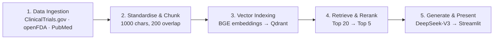

# 🩺 Clinical Trial Evidence Synthesis Assistant

**An Agentic RAG assistant for clinical trial evidence.**
Ask one medical question and get a single, source-grounded answer built from **ClinicalTrials.gov**, **openFDA** and **PubMed**.

🔗 **Live app:** [clinical-trial-assistant-bysk.streamlit.app](https://clinical-trial-assistant-bysk.streamlit.app)

> Capstone Project 2 · Post Graduate Program in Data Science & Analytics with GenAI · Imarticus Learning (Batch PGA-67)

---

## 📌 Overview

Clinical evidence is scattered across trial registries, safety reports and research journals. Searching each one by hand is slow, and general chatbots can sound confident while inventing facts.

This project solves that with a **Retrieval-Augmented Generation (RAG)** pipeline. It retrieves real documents first, reranks them, and lets an LLM write the answer **only from the retrieved evidence**. If the evidence is not enough, the assistant says so instead of guessing.

## ✨ Features

- **Multi-source retrieval** across ClinicalTrials.gov, openFDA adverse events and PubMed
- **Two-stage retrieval:** vector similarity search, then cross-encoder reranking
- **Structured answers** with a *Key Finding* and *Evidence* section, including NCT IDs
- **Transparency:** source badges and expandable evidence cards with retrieved documents and scores
- **Hallucination guardrail:** replies "The retrieved evidence does not contain enough information to answer this question." when nothing relevant is found
- **Streamlit web app** with a simple chat interface

## 🏗️ Workflow



| Step | What happens | Module |
|------|--------------|--------|
| 1. Data ingestion | Fetch trial records (studies JSON) from ClinicalTrials.gov, adverse events (JSON) from openFDA, and articles from PubMed via NCBI E-utilities | ingestion APIs |
| 2. Standardise & chunk | Convert all sources to one schema (`doc_id`, `source`, `title`, `text`, `metadata`), split text with character chunking (`CHUNK_SIZE = 1000`, `CHUNK_OVERLAP = 200`), export to `data/processed/chunks.jsonl` | `transformers.py`, `build_docs.py` |
| 3. Vector indexing | Embed chunks with `BAAI/bge-base-en-v1.5` (768 dimensions) and upsert vectors with metadata into the Qdrant collection `clinical_evidence` | `indexing.py` |
| 4. Retrieval & reranking | Route the query, fetch `N_CANDIDATES = 20` from Qdrant, rerank with the cross-encoder `ms-marco-MiniLM-L-6-v2`, keep `TOP_K = 5` | `retrieval.py` |
| 5. Generation & UI | Send the top evidence to `DeepSeek-V3` through the Hugging Face Inference API, then render the answer, source badges and evidence cards in Streamlit | `generation.py`, `app.py` |

## 🧰 Tech Stack

| Area | Tool |
|------|------|
| Language | Python |
| Data sources | ClinicalTrials.gov API, openFDA API, PubMed (NCBI E-utilities) |
| Embeddings | `BAAI/bge-base-en-v1.5` (768-dim) |
| Vector database | Qdrant |
| Reranker | `cross-encoder/ms-marco-MiniLM-L-6-v2` |
| LLM | DeepSeek-V3 via Hugging Face Inference API |
| Frontend / deployment | Streamlit |

## 🖼️ Screenshots

**Home screen**

.png)

**Question and sources evaluated**

.png)

**Key Finding and Evidence**

.png)

**Retrieved trials with NCT IDs**

.png)

**Hallucination test: out-of-scope question, no evidence, no answer**

.png)

## 🧪 Test Cases

| # | Query | Expected behaviour | Result |
|---|-------|--------------------|--------|
| 1 | What clinical trials are available for chronic hepatitis B? | Grounded trials with NCT IDs | ✅ Pass: returned trials for SA1211 (NCT07275918), pegylated interferon α-2b (NCT06323681), vesatolimod (NCT02166047) and adefovir dipivoxil (NCT00403585) |
| 2 | Who invented the telephone? (no evidence in the sources) | Decline instead of guessing | ✅ Pass: replied that the retrieved evidence does not contain enough information |

## 📁 Project Structure

```
.
├── app.py              # Streamlit UI
├── generation.py       # LLM answer synthesis (DeepSeek-V3)
├── retrieval.py        # Qdrant search + cross-encoder reranking
├── indexing.py         # Embeddings + Qdrant upsert
├── transformers.py     # Source payloads → unified schema
├── build_docs.py       # Chunking → data/processed/chunks.jsonl
├── data/
│   └── processed/
│       └── chunks.jsonl
├── images/             # README screenshots
├── requirements.txt
└── README.md
```

## 🚀 Getting Started

> Adjust file names, variables and commands below to match your repository.

**1. Clone and install**

```bash
git clone https://github.com/<your-username>/<your-repo>.git
cd <your-repo>
python -m venv venv
source venv/bin/activate        # Windows: venv\Scripts\activate
pip install -r requirements.txt
```

**2. Add your keys** (for example in a `.env` file or Streamlit secrets)

```
HF_TOKEN=your_hugging_face_token
QDRANT_URL=your_qdrant_url
QDRANT_API_KEY=your_qdrant_api_key
```

**3. Build the data and index (run once)**

```bash
python build_docs.py     # fetch, standardise and chunk
python indexing.py       # embed and upsert into Qdrant
```

**4. Run the app**

```bash
streamlit run app.py
```

## ⚠️ Limitations

- Limited to three data sources
- Answer quality depends on retrieval quality and chunking
- The reranker is trained on general web search data, not medical text
- Reranking and a hosted LLM add some response time
- Evaluation so far is manual test cases; no automated metrics yet

## 🔮 Future Scope

- More sources and filters by trial phase, status and location
- Clickable source links next to each cited trial
- Chat memory for follow-up questions
- Automated evaluation (for example faithfulness and retrieval accuracy)
- Knowledge graph of drug, trial and condition links
- Export evidence summary as PDF

## ⚕️ Disclaimer

This project is for **educational and research purposes only**. It is not medical advice and must not be used for diagnosis or treatment decisions. Always consult a qualified healthcare professional.

## 👩‍💻 Author

**Shristi Kumari** ·
Aspiring Data Analyst / Data Science & Machine Learning professional
